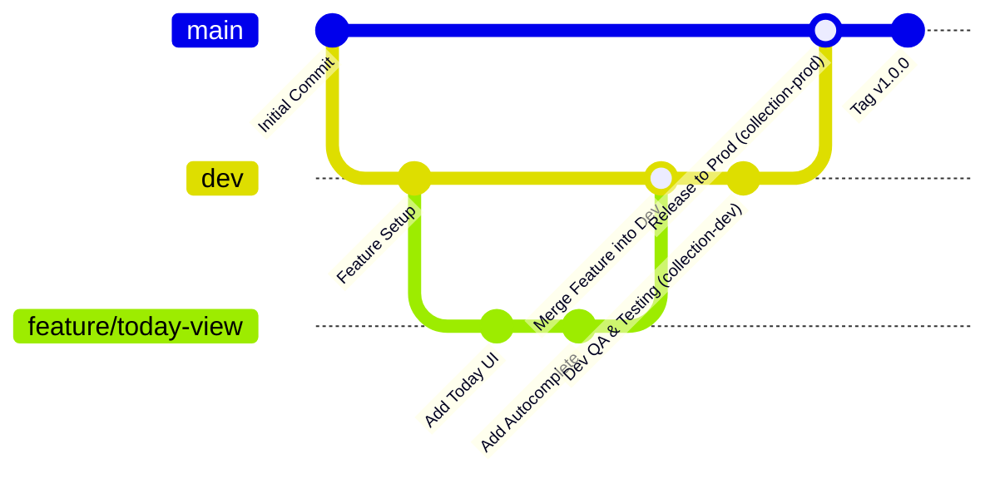

# Branching Strategy, Multi-Environment Configuration & Deployment Runbook

## 1. Branching Strategy & Git Workflow

The project follows a strict multi-environment Git branch model to guarantee that **no untested code or unverified database migration ever touches production data**.



### Branch Invariants:
1. **`main` (Production)**:
   * Protected branch. Direct pushes are blocked.
   * Only merges from `dev` via Pull Request after successful verification on preview environments.
   * Deploys automatically to the **Production URL** (e.g. `tracker.ithinkai.in` or `daily-tracker.pages.dev`).
   * Connected strictly to Supabase **`collection-prod`**.
2. **`dev` (Staging / Development)**:
   * The integration branch where completed features are combined and tested.
   * Deploys automatically to the **Dev Preview URL** (e.g. `dev-daily-tracker.pages.dev`).
   * Connected strictly to Supabase **`collection-dev`**.
3. **`feature/<name>`**:
   * Individual developer branches branching off from `dev`.
   * Merged into `dev` via Pull Request after unit testing and code review.

---

## 2. Dual Supabase Project Configuration (100% Free Tier)

Both environments operate under **one free-tier Supabase account** using the two free project slots. **There is zero shared data between them.**

| Attribute | Development (`collection-dev`) | Production (`collection-prod`) |
| :--- | :--- | :--- |
| **Supabase Project Name** | `collection-dev` | `collection-prod` |
| **Git Branch Target** | `dev` | `main` |
| **Hosting Deployment** | Cloudflare Pages / Vercel Preview / Render Static Site (`dev`) | Cloudflare Pages / Vercel Production / Render Static Site (`main`) |
| **Render Account** | `ithinksisolutions@gmail.com` | `ithinksisolutions@gmail.com` |
| **Data Character** | Synthetic mock data, fake test collectors | Real daily rupees, real client collectors |
| **Auth Users** | `operator1@ithinkai.in` (test password) | Real operator mobile credentials |
| **Bucket Storage** | `bill-slips` (sample test images) | `bill-slips` (real customer receipts) |
| **Automated Backups** | None (ephemeral) | Nightly GitHub Actions export (01:00 IST) |
| **Keep-Alive Cron** | Pinged weekly to prevent pausing | Pinged weekly to prevent pausing |

---

## 3. Environment Variables Configuration

The repository contains a template `.env.example`. **Actual keys are never committed to Git.**

```ini
# .env.example
VITE_SUPABASE_URL=https://your-project-id.supabase.co
VITE_SUPABASE_ANON_KEY=eyJhbGciOiJIUzI1NiIsInR5cCI6IkpXVCJ9...
VITE_APP_ENV=development
```

### Hosting Dashboard Configuration (Vercel / Cloudflare Pages)

In the hosting control panel (Settings -> Environment Variables), configure scoped values:

* **Production Environment (`main` branch)**:
  * `VITE_SUPABASE_URL` = `https://<prod-project-ref>.supabase.co`
  * `VITE_SUPABASE_ANON_KEY` = `<prod-anon-public-key>`
  * `VITE_APP_ENV` = `production`

* **Preview / Development Environment (`dev` branch)**:
  * `VITE_SUPABASE_URL` = `https://<dev-project-ref>.supabase.co`
  * `VITE_SUPABASE_ANON_KEY` = `<dev-anon-public-key>`
  * `VITE_APP_ENV` = `development`

---

## 4. Database Migrations Lifecycle (`supabase/migrations`)

All database changes (tables, indexes, triggers, and RLS policies) must be committed to Git as sequential SQL migration files inside `/supabase/migrations/`:

```text
supabase/migrations/
├── 001_initial_schema.sql         # Base tables, constraints, generated columns
├── 002_rls_security_policies.sql  # Row Level Security policies
├── 003_storage_buckets.sql        # Storage bucket & object security
└── 004_helper_rpcs.sql            # Autocomplete & get-or-create sheet functions
```

### Migration Execution Procedure:
1. **Local / Dev Step**:
   * Author the new `.sql` migration file.
   * Apply against `collection-dev` via Supabase CLI or SQL Editor:
     ```bash
     supabase db push --linked  # or execute via Supabase Dashboard SQL editor
     ```
   * Test client application against `dev` preview deployment.
2. **Production Release Step**:
   * Once testing passes on `dev`, merge `dev` into `main`.
   * Apply the exact same `.sql` file to `collection-prod`.
   * Verify using the production release checklist below.

---

## 5. Keep-Alive Automation (Prevent Supabase Free Inactivity Pausing)

Supabase pauses free-tier projects if they receive no API requests for 7 consecutive days. To ensure neither `collection-dev` nor `collection-prod` pauses during holidays or quiet business periods, a GitHub Action runs every 5 days to send a lightweight REST ping.

Create `.github/workflows/keep-alive.yml`:

```yaml
name: Supabase Free Tier Keep-Alive

on:
  schedule:
    # Runs at 06:00 UTC every 5th day of the month
    - cron: '0 6 */5 * *'
  workflow_dispatch:

jobs:
  ping:
    name: Keep Supabase Dev & Prod Unpaused
    runs-on: ubuntu-latest
    steps:
      - name: Ping Dev Database Health
        env:
          DEV_URL: ${{ secrets.DEV_SUPABASE_URL }}
          DEV_KEY: ${{ secrets.DEV_SUPABASE_ANON_KEY }}
        run: |
          echo "Pinging Dev instance..."
          curl -s -f -o /dev/null -X GET "${DEV_URL}/rest/v1/" \
            -H "apikey: ${DEV_KEY}" \
            -H "Authorization: Bearer ${DEV_KEY}" || echo "Dev ping finished"

      - name: Ping Prod Database Health
        env:
          PROD_URL: ${{ secrets.PROD_SUPABASE_URL }}
          PROD_KEY: ${{ secrets.PROD_SUPABASE_ANON_KEY }}
        run: |
          echo "Pinging Prod instance..."
          curl -s -f -o /dev/null -X GET "${PROD_URL}/rest/v1/" \
            -H "apikey: ${PROD_KEY}" \
            -H "Authorization: Bearer ${PROD_KEY}" || echo "Prod ping finished"
```

---

## 6. Production Release Checklist

Before merging a release from `dev` to `main`, execute this step-by-step checklist:

- [ ] **1. Migration Tested on Dev**: All new SQL migrations in `/supabase/migrations` executed on `collection-dev` without errors.
- [ ] **2. RLS Security Test**: Verified that a test collector cannot read past dates or update entries on `collection-dev`.
- [ ] **3. Build & Type Check**: `npm run build` passes locally with zero TypeScript or Vite errors.
- [ ] **4. i18n Verification**: All new strings exist in both `src/locales/en.json` and `src/locales/te.json`.
- [ ] **5. Backup Verification**: Run the `daily-backup.yml` action manually to ensure an immediate backup of production before deploying.
- [ ] **6. Apply Migrations to Prod**: Run the migration file on `collection-prod` in the Supabase SQL editor.
- [ ] **7. Merge PR**: Merge `dev` -> `main` on GitHub.
- [ ] **8. Verify Deployment**: Open the production URL, log in as Admin, and confirm successful load.

---

## 7. Emergency Rollback Runbook

### If a Frontend Bug is Detected in Production:
Both Cloudflare Pages and Vercel support **instant zero-downtime rollback**:
1. Open hosting dashboard (Vercel / Cloudflare Pages).
2. Go to **Deployments**.
3. Locate the previous stable production deployment.
4. Click **Instant Rollback / Promote to Production**.
5. The live site reverts immediately to the previous JavaScript bundle.

### If a Database Migration Needs Rollback:
1. Every migration file in `/supabase/migrations/` must have a corresponding rollback script (e.g. `002_rollback_rls_security_policies.sql`).
2. Run the rollback script in the Supabase SQL editor for `collection-prod`.
3. If data was corrupted, restore from the pre-deployment backup created in Step 5 of the Release Checklist (see `docs/BACKUP.md`).
