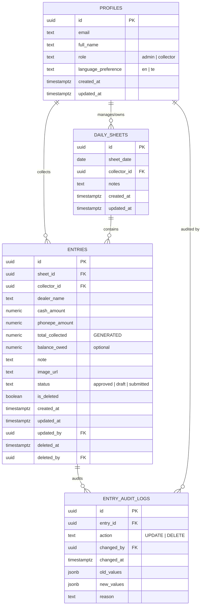

# Database Specification & Schema: Daily Collection Tracker

## 1. Architectural Decisions & Principles

1. **Server-Enforced Timezone (Indian Standard Time - Asia/Kolkata)**:
   * Field collectors operate in India. All date boundaries must strictly adhere to `Asia/Kolkata` (UTC+05:30).
   * A PostgreSQL helper function `get_current_ist_date()` ensures that regardless of device clock tampering or UTC server offsets, "Today" is always evaluated consistently.
2. **Atomic Split Payment Design**:
   * An entry represents a single interaction with a dealer.
   * `cash_amount` and `phonepe_amount` reside in the same row.
   * `total_collected` is computed deterministically via PostgreSQL's `GENERATED ALWAYS AS (cash_amount + phonepe_amount) STORED`.
   * A check constraint enforces `(cash_amount > 0 OR phonepe_amount > 0)`.
3. **Denormalized `collector_id` on `entries`**:
   * While `entries` references `daily_sheets(id)`, having `collector_id` directly on `entries` allows PostgreSQL Row Level Security (RLS) to evaluate permissions in index scans without expensive nested `JOIN` queries.
   * A database trigger automatically syncs `entries.collector_id = daily_sheets.collector_id`.
4. **Non-Destructive Soft Deletes & Automatic Audit Trail**:
   * Hard deletes are blocked. Admin deletes set `is_deleted = TRUE`, `deleted_at = NOW()`, and `deleted_by = auth.uid()`.
   * A database trigger intercepts all `UPDATE` operations and records full before/after JSON snapshots into `entry_audit_logs`.
5. **Phase 2 Forward-Compatibility**:
   * An entry status column (`status TEXT DEFAULT 'approved' CHECK (status IN ('approved', 'draft', 'submitted'))`) is included now. Phase 1 sets everything to `'approved'` by default, so Phase 2 slip OCR approval workflows can be introduced without destructive schema migrations.

---

## 2. Entity-Relationship Diagram (ERD)



---

## 3. Complete PostgreSQL DDL Script

The following script can be executed in the Supabase SQL Editor or applied via `supabase/migrations/001_initial_schema.sql`.

```sql
-- =============================================================================
-- 001_initial_schema.sql: Daily Collection Tracker Schema
-- =============================================================================

-- Enable required extensions
CREATE EXTENSION IF NOT EXISTS "uuid-ossp";
CREATE EXTENSION IF NOT EXISTS "pg_trgm";

-- -----------------------------------------------------------------------------
-- 1. Helper Function: Current IST Date
-- -----------------------------------------------------------------------------
CREATE OR REPLACE FUNCTION get_current_ist_date()
RETURNS DATE AS $$
BEGIN
    RETURN (now() AT TIME ZONE 'Asia/Kolkata')::date;
END;
$$ LANGUAGE plpgsql IMMUTABLE;

-- -----------------------------------------------------------------------------
-- 2. User Profiles Table
-- -----------------------------------------------------------------------------
CREATE TABLE public.profiles (
    id UUID PRIMARY KEY REFERENCES auth.users(id) ON DELETE CASCADE,
    email TEXT NOT NULL,
    full_name TEXT NOT NULL,
    role TEXT NOT NULL DEFAULT 'collector' CHECK (role IN ('admin', 'collector')),
    language_preference TEXT NOT NULL DEFAULT 'en' CHECK (language_preference IN ('en', 'te')),
    created_at TIMESTAMPTZ NOT NULL DEFAULT now(),
    updated_at TIMESTAMPTZ NOT NULL DEFAULT now()
);

-- Index on role for fast authorization checks
CREATE INDEX idx_profiles_role ON public.profiles(role);

-- -----------------------------------------------------------------------------
-- 3. Daily Sheets Table
-- -----------------------------------------------------------------------------
CREATE TABLE public.daily_sheets (
    id UUID PRIMARY KEY DEFAULT gen_random_uuid(),
    sheet_date DATE NOT NULL,
    collector_id UUID NOT NULL REFERENCES public.profiles(id) ON DELETE RESTRICT,
    notes TEXT,
    created_at TIMESTAMPTZ NOT NULL DEFAULT now(),
    updated_at TIMESTAMPTZ NOT NULL DEFAULT now(),
    CONSTRAINT uq_sheet_date_collector UNIQUE (sheet_date, collector_id)
);

CREATE INDEX idx_daily_sheets_date ON public.daily_sheets(sheet_date);
CREATE INDEX idx_daily_sheets_collector_date ON public.daily_sheets(collector_id, sheet_date);

-- -----------------------------------------------------------------------------
-- 4. Entries Table
-- -----------------------------------------------------------------------------
CREATE TABLE public.entries (
    id UUID PRIMARY KEY DEFAULT gen_random_uuid(),
    sheet_id UUID NOT NULL REFERENCES public.daily_sheets(id) ON DELETE CASCADE,
    collector_id UUID NOT NULL REFERENCES public.profiles(id) ON DELETE RESTRICT,
    dealer_name TEXT NOT NULL,
    cash_amount NUMERIC(12,2) NOT NULL DEFAULT 0.00 CHECK (cash_amount >= 0),
    phonepe_amount NUMERIC(12,2) NOT NULL DEFAULT 0.00 CHECK (phonepe_amount >= 0),
    total_collected NUMERIC(12,2) GENERATED ALWAYS AS (cash_amount + phonepe_amount) STORED,
    balance_owed NUMERIC(12,2) NULL CHECK (balance_owed IS NULL OR balance_owed >= 0),
    note TEXT,
    image_url TEXT,
    status TEXT NOT NULL DEFAULT 'approved' CHECK (status IN ('approved', 'draft', 'submitted')),
    is_deleted BOOLEAN NOT NULL DEFAULT FALSE,
    created_at TIMESTAMPTZ NOT NULL DEFAULT now(),
    updated_at TIMESTAMPTZ NOT NULL DEFAULT now(),
    updated_by UUID REFERENCES public.profiles(id),
    deleted_at TIMESTAMPTZ NULL,
    deleted_by UUID REFERENCES public.profiles(id),
    CONSTRAINT chk_at_least_one_payment CHECK (cash_amount > 0 OR phonepe_amount > 0)
);

CREATE INDEX idx_entries_sheet_id ON public.entries(sheet_id) WHERE is_deleted = FALSE;
CREATE INDEX idx_entries_collector_id ON public.entries(collector_id) WHERE is_deleted = FALSE;
CREATE INDEX idx_entries_created_at ON public.entries(created_at);
CREATE INDEX idx_entries_dealer_name_trgm ON public.entries USING gin (dealer_name gin_trgm_ops);

-- -----------------------------------------------------------------------------
-- 5. Entry Audit Logs Table
-- -----------------------------------------------------------------------------
CREATE TABLE public.entry_audit_logs (
    id UUID PRIMARY KEY DEFAULT gen_random_uuid(),
    entry_id UUID NOT NULL REFERENCES public.entries(id) ON DELETE CASCADE,
    action TEXT NOT NULL CHECK (action IN ('UPDATE', 'DELETE')),
    changed_by UUID NOT NULL REFERENCES public.profiles(id),
    changed_at TIMESTAMPTZ NOT NULL DEFAULT now(),
    old_values JSONB NOT NULL,
    new_values JSONB,
    reason TEXT
);

CREATE INDEX idx_audit_entry_id ON public.entry_audit_logs(entry_id);
CREATE INDEX idx_audit_changed_at ON public.entry_audit_logs(changed_at);

-- -----------------------------------------------------------------------------
-- 6. Trigger: Updated At Auto-Update
-- -----------------------------------------------------------------------------
CREATE OR REPLACE FUNCTION set_updated_at_timestamp()
RETURNS TRIGGER AS $$
BEGIN
    NEW.updated_at = now();
    RETURN NEW;
END;
$$ LANGUAGE plpgsql;

CREATE TRIGGER trg_profiles_updated_at
BEFORE UPDATE ON public.profiles
FOR EACH ROW EXECUTE FUNCTION set_updated_at_timestamp();

CREATE TRIGGER trg_daily_sheets_updated_at
BEFORE UPDATE ON public.daily_sheets
FOR EACH ROW EXECUTE FUNCTION set_updated_at_timestamp();

CREATE TRIGGER trg_entries_updated_at
BEFORE UPDATE ON public.entries
FOR EACH ROW EXECUTE FUNCTION set_updated_at_timestamp();

-- -----------------------------------------------------------------------------
-- 7. Trigger: Auto-populate Collector ID on Entries from Sheet
-- -----------------------------------------------------------------------------
CREATE OR REPLACE FUNCTION sync_entry_collector_id()
RETURNS TRIGGER AS $$
BEGIN
    IF NEW.collector_id IS NULL THEN
        SELECT collector_id INTO NEW.collector_id
        FROM public.daily_sheets
        WHERE id = NEW.sheet_id;
    END IF;
    RETURN NEW;
END;
$$ LANGUAGE plpgsql;

CREATE TRIGGER trg_sync_entry_collector
BEFORE INSERT ON public.entries
FOR EACH ROW EXECUTE FUNCTION sync_entry_collector_id();

-- -----------------------------------------------------------------------------
-- 8. Trigger: Audit Logging for Admin Edits & Deletes
-- -----------------------------------------------------------------------------
CREATE OR REPLACE FUNCTION audit_entry_mutation()
RETURNS TRIGGER AS $$
DECLARE
    v_user_id UUID;
    v_action TEXT;
BEGIN
    v_user_id := auth.uid();

    -- Determine if this is a soft-delete or a standard update
    IF (OLD.is_deleted = FALSE AND NEW.is_deleted = TRUE) THEN
        v_action := 'DELETE';
    ELSE
        v_action := 'UPDATE';
    END IF;

    INSERT INTO public.entry_audit_logs (
        entry_id,
        action,
        changed_by,
        changed_at,
        old_values,
        new_values,
        reason
    ) VALUES (
        NEW.id,
        v_action,
        COALESCE(v_user_id, NEW.updated_by, NEW.collector_id),
        now(),
        to_jsonb(OLD),
        to_jsonb(NEW),
        COALESCE(NEW.note, 'Modified by Admin')
    );

    RETURN NEW;
END;
$$ LANGUAGE plpgsql SECURITY DEFINER;

CREATE TRIGGER trg_audit_entries
AFTER UPDATE ON public.entries
FOR EACH ROW
WHEN (OLD.* IS DISTINCT FROM NEW.*)
EXECUTE FUNCTION audit_entry_mutation();

-- -----------------------------------------------------------------------------
-- 9. Trigger: Handle New User Signup from auth.users
-- -----------------------------------------------------------------------------
CREATE OR REPLACE FUNCTION public.handle_new_user()
RETURNS TRIGGER AS $$
BEGIN
    INSERT INTO public.profiles (id, email, full_name, role, language_preference)
    VALUES (
        NEW.id,
        NEW.email,
        COALESCE(NEW.raw_user_meta_data->>'full_name', split_part(NEW.email, '@', 1)),
        COALESCE(NEW.raw_user_meta_data->>'role', 'collector'),
        COALESCE(NEW.raw_user_meta_data->>'language_preference', 'en')
    );
    RETURN NEW;
END;
$$ LANGUAGE plpgsql SECURITY DEFINER;

CREATE TRIGGER on_auth_user_created
AFTER INSERT ON auth.users
FOR EACH ROW EXECUTE FUNCTION public.handle_new_user();

-- -----------------------------------------------------------------------------
-- 10. RPC: Safe Get-or-Create Daily Sheet for Collector
-- -----------------------------------------------------------------------------
CREATE OR REPLACE FUNCTION get_or_create_daily_sheet(p_collector_id UUID, p_date DATE)
RETURNS UUID AS $$
DECLARE
    v_sheet_id UUID;
BEGIN
    -- Check if sheet already exists
    SELECT id INTO v_sheet_id
    FROM public.daily_sheets
    WHERE collector_id = p_collector_id AND sheet_date = p_date;

    IF v_sheet_id IS NULL THEN
        -- Insert new sheet with ON CONFLICT safety
        INSERT INTO public.daily_sheets (collector_id, sheet_date)
        VALUES (p_collector_id, p_date)
        ON CONFLICT (sheet_date, collector_id)
        DO UPDATE SET updated_at = now()
        RETURNING id INTO v_sheet_id;
    END IF;

    RETURN v_sheet_id;
END;
$$ LANGUAGE plpgsql SECURITY DEFINER;

-- -----------------------------------------------------------------------------
-- 11. RPC: Dealer Name Autocomplete Suggestions
-- -----------------------------------------------------------------------------
CREATE OR REPLACE FUNCTION get_dealer_suggestions(search_query TEXT, max_limit INT DEFAULT 10)
RETURNS TABLE (dealer_name TEXT, last_used TIMESTAMPTZ) AS $$
BEGIN
    RETURN QUERY
    SELECT DISTINCT ON (e.dealer_name)
        e.dealer_name,
        e.created_at as last_used
    FROM public.entries e
    WHERE e.is_deleted = FALSE
      AND (search_query = '' OR e.dealer_name ILIKE '%' || search_query || '%')
    ORDER BY e.dealer_name, e.created_at DESC
    LIMIT max_limit;
END;
$$ LANGUAGE plpgsql STABLE SECURITY DEFINER;
```

---

## 4. Supabase Storage Configuration

* **Bucket Name**: `bill-slips`
* **Access Level**: Private (protected by Storage RLS policies).
* **Allowed MIME types**: `image/jpeg`, `image/png`, `image/webp`.
* **Max File Size**: `5 MB` (client compresses image to ~500 KB before upload).

```sql
-- Storage bucket initialization
INSERT INTO storage.buckets (id, name, public, file_size_limit, allowed_mime_types)
VALUES (
    'bill-slips',
    'bill-slips',
    false,
    5242880,
    ARRAY['image/jpeg', 'image/png', 'image/webp']
)
ON CONFLICT (id) DO NOTHING;
```

---

## 5. Seed Data Strategy (for `collection-dev`)

To ensure realistic testing in the development environment without touching production, the following seed script sets up:
* 1 Admin account (`admin@ithinkai.in`)
* 3 Operator accounts (`operator1@ithinkai.in`, `operator2@ithinkai.in`, `operator3@ithinkai.in`)
* Real dealer names and amounts matching the client's actual collection slip dated 07-10-2026.

```sql
-- Seed script: run in collection-dev only
DO $$
DECLARE
    v_admin_id UUID := gen_random_uuid();
    v_op1_id UUID := gen_random_uuid();
    v_op2_id UUID := gen_random_uuid();
    v_op3_id UUID := gen_random_uuid();
    v_today DATE := (now() AT TIME ZONE 'Asia/Kolkata')::date;
    v_sheet1_id UUID;
    v_sheet2_id UUID;
BEGIN
    -- For local/dev database mocking:
    INSERT INTO public.profiles (id, email, full_name, role, language_preference)
    VALUES
        (v_admin_id, 'admin@ithinkai.in', 'Admin (Srinivas)', 'admin', 'en'),
        (v_op1_id, 'operator1@ithinkai.in', 'Operator 1 (Ramesh)', 'collector', 'te'),
        (v_op2_id, 'operator2@ithinkai.in', 'Operator 2 (Venkat)', 'collector', 'te'),
        (v_op3_id, 'operator3@ithinkai.in', 'Operator 3 (Mahesh)', 'collector', 'en')
    ON CONFLICT (id) DO NOTHING;

    -- Create sheets for today
    INSERT INTO public.daily_sheets (sheet_date, collector_id)
    VALUES (v_today, v_op1_id) RETURNING id INTO v_sheet1_id;

    INSERT INTO public.daily_sheets (sheet_date, collector_id)
    VALUES (v_today, v_op2_id) RETURNING id INTO v_sheet2_id;

    -- Add entries from real handwritten collection slip
    INSERT INTO public.entries (sheet_id, collector_id, dealer_name, cash_amount, phonepe_amount, balance_owed, note)
    VALUES
        -- Operator 1 Cash & PhonePe Collections
        (v_sheet1_id, v_op1_id, 'ANGLI LAHT', 6000.00, 0.00, 72370.00, 'Cash collection'),
        (v_sheet1_id, v_op1_id, 'MDVD KHAN', 3000.00, 0.00, 6825.00, 'Cash collection'),
        (v_sheet1_id, v_op1_id, 'MDVD SURESH', 500.00, 0.00, 3820.00, 'Cash collection'),
        (v_sheet1_id, v_op1_id, 'MPL MAHESWARA', 0.00, 40000.00, 87500.00, 'PhonePe collection (TOTAL P.P)'),
        -- Operator 2 PhonePe Collections
        (v_sheet2_id, v_op2_id, 'KTKD KUSHAL', 0.00, 5000.00, 36512.00, 'PhonePe collection R.P.P'),
        (v_sheet2_id, v_op2_id, 'SRGP Gangadhar', 0.00, 5000.00, 10000.00, 'PhonePe collection'),
        (v_sheet2_id, v_op2_id, 'GKD Vinayaka (ARBOPLAST)', 0.00, 2500.00, 0.00, 'PhonePe settlement - Nil balance');
END $$;
```

---

## 6. Database Risks & Mitigation

| Database Risk | Consequence | Technical Mitigation |
| :--- | :--- | :--- |
| **Race Condition on Sheet Creation** | Two simultaneous entry submissions create duplicate sheets. | Handled via `ON CONFLICT (sheet_date, collector_id)` constraint inside the `get_or_create_daily_sheet` RPC. |
| **Rounding Errors in Currency** | Mismatches between cash + PhonePe vs grand total. | Strict use of `NUMERIC(12,2)` throughout; float/real types are forbidden. Totals are derived automatically via `GENERATED ALWAYS AS`. |
| **Slow Autocomplete on Large Dealer Lists** | Latency when collector types in search box. | `pg_trgm` GIN index on `dealer_name` ensures sub-millisecond prefix and substring lookups even at 50,000+ entries. |
| **Collector Tampering with Sheet Date** | Collector sends payload pointing to a past sheet ID. | RLS policy verifies that `sheet_id` belongs to a sheet whose `sheet_date = get_current_ist_date()`. |
