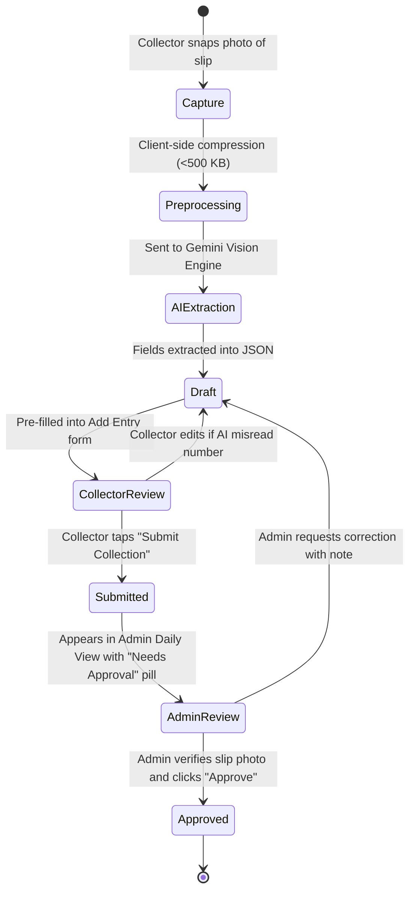

# Phase 2 Architecture: AI/OCR Bill Slip Upload & Approval Workflow

## 1. Executive Summary & Objectives

In Phase 1 (MVP), collectors manually type the dealer name, cash amount, and PhonePe amount, with an optional photo attachment of the handwritten slip for verification.

In **Phase 2**, the app introduces an **AI-Assisted Slip Digitizer**:
1. The collector captures a photo of the handwritten collection slip.
2. An AI Vision engine extracts the fields automatically: **Dealer Name**, **Cash Amount**, **PhonePe Amount**, and **Balance Owed**.
3. The fields are pre-filled into the entry form on the collector's screen in seconds.
4. The collector reviews, corrects any misread numbers, and taps **Submit**.
5. The entry enters an approval workflow: `draft` -> `submitted` -> `approved`.
6. The Admin reviews pending slips and approves or adjusts them.
7. **Manual entry remains 100% available at all times as the immediate fallback.**

---

## 1.1 Real-World Slip Analysis (From User's Attached Slip)

Analysis of the client's actual pink handwritten collection slip dated **07-10-2026**:

| Line | Dealer Name | Cash (₹) | PhonePe (P.P) (₹) | Balance Owed (₹) | Slip Notation & Notes |
| :--- | :--- | :--- | :--- | :--- | :--- |
| 1 | `ANGLI LAHT` | 6,000.00 | - | 72,370.00 | Pure cash collection |
| 2 | `MDVD KHAN` | 3,000.00 | - | 6,825.00 | Pure cash collection |
| 3 | `MDVD SURESH` | 500.00 | - | 3,820.00 | Pure cash collection |
| **Subtotal** | **TOTAL CASH** | **9,500.00** | - | - | Matches `6000 + 3000 + 500 = 9500` |
| 4 | `MPL MAHESWARA` | - | 40,000.00 | 87,500.00 | PhonePe collection |
| 5 | `MDVD SURESH` | - | 2,000.00 | 3,820.00 | Circled as `R.P.P 2000` (PhonePe) |
| 6 | `KTKD KUSHAL` | - | 5,000.00 | 36,512.00 | Circled as `R.P.P 5000` (PhonePe) |
| 7 | `SRGP Gangadhar` | - | 5,000.00 | 10,000.00 | PhonePe collection |
| **Subtotal** | **TOTAL P.P** | - | **52,000.00** | - | Matches `40000 + 2000 + 5000 + 5000 = 52,000` |
| 8 | `ARBOPLAST (GKD Vinayaka)` | - | 2,500.00 | 0.00 (Nil) | Marked `Nill` balance |
| 9 | `SRGP Gangadhar` | - | 10,000.00 | 10,791.00 | Marked `TOTAL P.P 10000/-` |

### Key Takeaways for OCR Parsing:
1. **Three Column Format**: Columns are consistently `[ Dealer Name ] [ Collected Amount ] [ Balance Owed ]`.
2. **Payment Mode Markers**: Pure cash amounts are listed first under `TOTAL CASH`; PhonePe collections are marked as `P.P` or `R.P.P` with subtotals `TOTAL P.P`.
3. **Balance Owed**: Represents the static outstanding balance after the payment, or `Nill` (0).
4. **Dates**: Written as `dd-mm-yyyy` at the top right (`07-10-2026`).

---

## 2. Evaluation of Free-Tier OCR & Vision Options

A strict project constraint is: **Free tier only, NO credit card required**.

| Technology | Free Quota | Credit Card Needed? | Accuracy on Indian Handwritten Slips | Structured JSON Output | Verdict |
| :--- | :--- | :--- | :--- | :--- | :--- |
| **Google Gemini Flash (Google AI Studio)** | **15 RPM / 1,500 RPD Free** | ❌ **NO Credit Card** (Free API Key from Google AI Studio) | **Exceptional** (Excels at handwriting, Telugu/English script, and rupee notation) | Native `response_schema` (Pydantic / JSON Schema) | **WINNER (Selected)** |
| **Tesseract.js (Client-side WASM)** | Unlimited (Runs in browser) | ❌ NO | **Very Poor** (<25% on handwritten Indian receipts) | ❌ Requires complex regex parsing | Rejected |
| **Google Cloud Vision API** | 1,000 calls / month free | ⚠️ **YES (Mandatory credit card for GCP project)** | High for printed text; Moderate for handwriting | ❌ Raw OCR text only; no semantic understanding | Rejected (Violates constraint) |
| **Python FastAPI on Render / Hugging Face Spaces** | 100% Free Tier (CPU Basic) | ❌ NO | Same as underlying model (uses Gemini SDK) | Native JSON formatting | **Viable as Proxy Service** |

### Selected Architecture:
* **Primary AI Engine**: **Google Gemini 2.0 / 1.5 Flash** via free Google AI Studio API key.
* **Hosting Options**:
  * *Option A (Direct / Edge Function)*: Supabase Edge Function (Deno/TypeScript) proxying the request to Gemini AI Studio.
  * *Option B (Python Microservice)*: FastAPI service deployed on **Hugging Face Spaces (Docker/Python, 100% free, no credit card)**.

---

## 3. End-to-End Workflow & State Machine



### State Definitions:
* **`draft`**: The entry has been created from slip OCR or saved locally on the collector's device, but has not yet been finalized by the collector.
* **`submitted`**: The collector has verified the amounts and submitted the record to the database for today. The amounts count toward today's live tally with a "Pending Approval" status badge.
* **`approved`**: The Admin has reviewed the uploaded slip image against the entered numbers and approved the entry.

---

## 4. Phase 1 Forward-Compatibility (Zero Breaking Changes)

To ensure Phase 1 does not block Phase 2, the following design provisions are built into the database schema and storage from Day One:

1. **`entries.status` Column**:
   * Already defined in Phase 1 as: `status TEXT NOT NULL DEFAULT 'approved' CHECK (status IN ('approved', 'draft', 'submitted'))`.
   * In Phase 1, all entries default to `'approved'`. In Phase 2, entries submitted via slip upload can transition from `'submitted'` to `'approved'`.
2. **`entries.image_url` Column**:
   * Already present in Phase 1 to store uploaded slips in the `bill-slips` bucket.
3. **Storage Bucket `bill-slips`**:
   * Initialized with RLS policies allowing collectors to upload and Admin to view.

---

## 5. Vision AI Prompt & Structured Schema

When the slip image is submitted to Gemini 1.5/2.0 Flash, the following system prompt and JSON schema are enforced:

### System Prompt
```text
You are an expert Indian financial document reader. You are analyzing a photo of a handwritten daily collection slip from a wholesale dealer or shop in India.

Extract the following fields accurately:
1. dealer_name: The name of the shop or dealer (often written in English or Telugu).
2. cash_amount: Numerical rupees paid in physical cash. Defaults to 0.00 if only online.
3. phonepe_amount: Numerical rupees paid via PhonePe / UPI / QR. Defaults to 0.00 if only cash.
4. total_collected: Total rupees collected (cash + phonepe).
5. balance_owed: Remaining balance the dealer still owes after this payment, if noted on the slip. Return null if not mentioned.
6. note: Any handwritten notes, UTR numbers, or discount remarks.

Rules:
- Be conservative with numbers. If a digit is ambiguous between 1 and 7, note your confidence in the note field.
- Remove all currency symbols (₹, Rs, /-) and commas. Return numbers as floats.
```

### Response JSON Schema
```json
{
  "type": "object",
  "properties": {
    "dealer_name": { "type": "string" },
    "cash_amount": { "type": "number" },
    "phonepe_amount": { "type": "number" },
    "total_collected": { "type": "number" },
    "balance_owed": { "type": ["number", "null"] },
    "note": { "type": ["string", "null"] },
    "confidence_score": { "type": "number", "description": "0.0 to 1.0" }
  },
  "required": ["dealer_name", "cash_amount", "phonepe_amount", "total_collected"]
}
```

---

## 6. Phase 2 Screen Wireframes

### Collector Slip Scanner Screen (`/today/scan`)
```text
+-------------------------------------------------------------+
| [< Cancel]             Scan Collection Slip                 |
+-------------------------------------------------------------+
|                                                             |
|           +-------------------------------------+           |
|           |                                     |           |
|           |        [ Camera Viewfinder ]        |           |
|           |      Align handwritten slip here    |           |
|           |                                     |           |
|           +-------------------------------------+           |
|                                                             |
|   [ 📷 Take Photo ]               [ 📁 Pick from Gallery ]  |
|                                                             |
| ----------------------------------------------------------- |
| [ AI Reading in Progress... ]                               |
| ⏳ Analyzing handwriting with Gemini Vision... (1.8s)       |
|                                                             |
| EXTRACTED PREVIEW (Please verify before saving):            |
|                                                             |
| Dealer Name:   [ Sri Lakshmi Supermarket                  ] |
| Cash Amount:   [ ₹ 1,500.00                               ] |
| PhonePe:       [ ₹ 3,500.00                               ] |
| Total:           ₹ 5,000.00                                 |
| Balance Owed:  [ ₹ 2,000.00                               ] |
|                                                             |
| Slip Photo:    [ Thumbnail: slip_482.jpg ]                  |
|                                                             |
| +---------------------------------------------------------+ |
| |          SUBMIT FOR APPROVAL / సేవ్ చేయండి               | |
| |                    (52px Button)                        | |
| +---------------------------------------------------------+ |
|                                                             |
| [ Switch to Manual Typing Fallback ]                        |
+-------------------------------------------------------------+
```

### Admin Pending Approvals View (`/admin/daily?tab=pending`)
```text
+----------------------------------------------------------------------------------------------------+
| [Tracker Logo]   [ Daily View ]   [ Dashboard ]   [ Pending Slips (3) 🔴 ]   Admin   [ EN | తెలుగు ]|
+----------------------------------------------------------------------------------------------------+
| PENDING BILL SLIP APPROVALS (18-Oct-2026):                                                         |
|                                                                                                    |
| +-------------------------+-----------------------------------+----------------------------------+ |
| | Slip Photo              | Extracted & Submitted Data        | Actions                          | |
| +-------------------------+-----------------------------------+----------------------------------+ |
| | [ Image Thumbnail ]     | Dealer: Sri Lakshmi Supermarket   | [ ✅ Approve Entry ]             | |
| | (Click to Zoom)         | Collector: Ramesh Kumar           |                                  | |
| |                         | Cash: ₹ 1,500 | PhonePe: ₹ 3,500  | [ ✏️ Edit Numbers ]              | |
| |                         | Total: ₹ 5,000.00                 |                                  | |
| |                         | Bal Owed: ₹ 2,000.00              | [ ❌ Reject Back to Collector ]  | |
| +-------------------------+-----------------------------------+----------------------------------+ |
+----------------------------------------------------------------------------------------------------+
```

---

## 7. Python Microservice Implementation (Optional Free Deployment)

If the team prefers a dedicated Python microservice rather than Supabase Edge Functions, it can be deployed on **Hugging Face Spaces** (Free Docker container, 16GB RAM, no credit card required) using FastAPI:

```python
# main.py - FastAPI Slip Extractor
from fastapi import FastAPI, File, UploadFile, HTTPException
import google.generativeai as genai
import os
import json
from pydantic import BaseModel

app = FastAPI(title="Daily Tracker Bill Slip OCR")

genai.configure(api_key=os.getenv("GEMINI_API_KEY"))
model = genai.GenerativeModel("gemini-1.5-flash")

class ExtractedSlip(BaseModel):
    dealer_name: str
    cash_amount: float
    phonepe_amount: float
    total_collected: float
    balance_owed: float | None = None
    note: str | None = None

@app.post("/extract-slip", response_model=ExtractedSlip)
async def extract_slip(file: UploadFile = File(...)):
    if file.content_type not in ["image/jpeg", "image/png", "image/webp"]:
        raise HTTPException(status_code=400, detail="Invalid image type")

    image_bytes = await file.read()
    
    prompt = """
    Extract from this Indian collection slip:
    dealer_name, cash_amount, phonepe_amount, total_collected, balance_owed, note.
    Return strictly valid JSON matching the schema.
    """
    
    response = model.generate_content([
        {"mime_type": file.content_type, "data": image_bytes},
        prompt
    ], generation_config={"response_mime_type": "application/json"})

    data = json.loads(response.text)
    return data
```

---

## 8. Phase 2 Implementation Tasks & Risks

### Task Breakdown:
1. **P2-T1**: Create free Google AI Studio API key and store as secret in Supabase / GitHub.
2. **P2-T2**: Build client-side image capture component with canvas compression (resizes images to max 1280px width, ~400 KB).
3. **P2-T3**: Deploy extraction endpoint (Supabase Edge Function or Hugging Face Space).
4. **P2-T4**: Connect extraction output to auto-fill the Add Entry form.
5. **P2-T5**: Implement Admin Pending Approvals tab and single-click approval action.

### Risks & Mitigations:
* **Illegible Handwriting / Crumpled Paper**:
  * *Mitigation*: The app treats AI output purely as an **initial guess**. The collector must view the pre-filled fields and can overwrite any value before hitting submit.
* **API Rate Limiting (15 RPM free tier)**:
  * *Mitigation*: 3 collectors submitting 15 slips spaced throughout a whole day will average fewer than 0.1 requests per minute, well below the 15 RPM limit.
