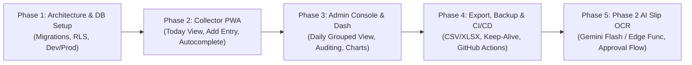

# Project Plan: Daily Collection Tracker

## 1. Executive Summary & Core Objective

The **Daily Collection Tracker** is a purpose-built, mobile-first Progressive Web Application (PWA) designed to replace physical handwritten daily collection notebooks used by field collectors.

### What This App IS:
* A streamlined tool for 3 field collectors to log daily cash and PhonePe collections as they happen.
* A real-time monitoring dashboard and audit-controlled administration portal for 1 client (Admin).
* An immutable audit trail of every rupee collected on each specific calendar date.

### What This App IS NOT:
* **No Dealer Balance Ledger**: It does not maintain running ledger balances across multiple days or historical balance accounts.
* **No Invoicing or Billing Generation**: It does not generate GST invoices or tax receipts.
* **No Balance Reports**: It reports purely on **money collected** per date, with an optional spot-observation of what the dealer still owes at the time of payment (`balance_owed`).

---

## 2. Technical Stack & Zero-Cost Constraints

Every component is chosen to guarantee **100% free-tier operation without requiring a credit card**.

| Component | Technology | Free Tier Guarantee & Rationale |
| :--- | :--- | :--- |
| **Frontend Framework** | React 18 / 19 + Vite + TypeScript | High performance, lightweight bundle, strict typing. |
| **Application Type** | Progressive Web App (`vite-plugin-pwa`) | One codebase for desktop web and installable mobile app on Android & iOS. No app store fees. Works offline for app shell. |
| **Styling & UI Polish** | Tailwind CSS + Lucide Icons + Framer Motion | **Fortune 5 caliber mobile aesthetic**: Stripe/Apple-grade precision, glassmorphism cards, fluid micro-interactions, 52px+ touch targets, instant zero-latency feedback. |
| **Multi-Business Support** | Dual Business Architecture (`STAR` & `ARBO PLAST`) | Clean business attribution per entry with smooth pill filters (`[ ALL | STAR | ARBO PLAST ]`). |
| **Backend & Database** | Supabase (PostgreSQL 17+ on AP region) | Connected and configured with RLS, triggers, generated columns, and storage buckets. |
| **Security & Auth** | Supabase Auth + Row Level Security (RLS) | Security enforced at PostgreSQL engine level. Zero custom backend required for MVP. |
| **Hosting & CI/CD** | Render / Cloudflare Pages / Vercel Free Tier | Unlimited deployments, automatic preview URLs for `dev`, production URLs for `main`. Free custom domains with SSL. |
| **Internationalization** | `i18next` + `react-i18next` | Client-side localization supporting English (`en`) and Telugu (`te`). User choice stored in profile and persisted locally. |
| **Date & Currency Utils** | Native `Intl` + `date-fns` | Strict `dd-mon-yyyy` (e.g. `07-Oct-2026`) and Indian Rupee formatting (`₹ 1,23,456.00`). |

---

## 3. High-Level System Architecture

```mermaid
flowchart TD
    subgraph Clients["Frontend Clients (PWA - Mobile & Web)"]
        CollectorClient["Collector Mobile PWA<br/>(Only Today's Date - IST)"]
        AdminClient["Admin Web & Mobile PWA<br/>(All Dates & Dashboard)"]
    end

    subgraph Hosting["Hosting & CDN (Cloudflare Pages / Vercel)"]
        DevDeploy["dev branch -> dev-preview.pages.dev"]
        ProdDeploy["main branch -> tracker-prod.pages.dev"]
    end

    subgraph SupabaseDev["Supabase DEV Project (collection-dev)"]
        DevDB[(Dev PostgreSQL)]
        DevAuth[Dev Auth]
        DevStorage[Dev Storage]
    end

    subgraph SupabaseProd["Supabase PROD Project (collection-prod)"]
        ProdDB[(Prod PostgreSQL)]
        ProdAuth[Prod Auth]
        ProdStorage[Prod Storage]
        RLS[PostgreSQL Row Level Security]
    end

    subgraph Automation["GitHub Actions (Free)"]
        DailyBackup["Daily DB Backup to Private Repo / Drive"]
        KeepAlive["Weekly Keep-Alive Ping (Prevents Pausing)"]
    end

    CollectorClient -->|VITE_SUPABASE_URL (Prod)| ProdAuth
    CollectorClient -->|Enforced by RLS| ProdDB
    CollectorClient -->|Upload bill slip| ProdStorage

    AdminClient -->|VITE_SUPABASE_URL (Prod)| ProdAuth
    AdminClient -->|Full Access via RLS| ProdDB

    DevDeploy --> SupabaseDev
    ProdDeploy --> SupabaseProd

    Automation -.->|Automated pg_dump / API Export| ProdDB
    Automation -.->|REST Ping| SupabaseDev
    Automation -.->|REST Ping| SupabaseProd
```

---

## 4. Key Architectural Decisions (ADRs)

### ADR-01: Row Level Security (RLS) as the Primary Security Boundary
* **Decision**: Eliminate any intermediate Node.js/Express backend. All authorization rules are written directly in PostgreSQL RLS policies.
* **Rationale**: Guarantees zero infrastructure costs, zero server maintenance, and prevents collectors from accessing past dates or other collectors' records even if they manipulate client-side JavaScript.

### ADR-02: Server-Enforced Indian Standard Time (IST, UTC+05:30)
* **Decision**: Collector access to "Today" is calculated strictly on PostgreSQL using `(now() AT TIME ZONE 'Asia/Kolkata')::date`.
* **Rationale**: Mobile device clocks can be altered by users or misconfigured. Using database-computed IST ensures that at 12:01 AM IST, the active day flips consistently for all collectors regardless of device settings.

### ADR-03: Single Sheet per Collector per Date (`daily_sheets`)
* **Decision**: Group all daily entries under a parent record in `daily_sheets` with a unique constraint on `(sheet_date, collector_id)`.
* **Rationale**: Prevents orphaned entries, simplifies daily subtotal calculations, and mirrors the real-world physical sheet handed to each collector every morning.

### ADR-04: Split Payment as Atomic Entry
* **Decision**: An entry captures both `cash_amount` and `phonepe_amount` on the same row, computing `total_collected = cash_amount + phonepe_amount` as a generated column. Blank PhonePe defaults to 0 (cash-only).
* **Rationale**: In Indian field collections, a dealer often hands over ₹500 in physical cash and pays the remaining ₹1,500 via PhonePe QR scan. Treating this as two separate records causes reconciliation confusion. One dealer visit = one entry.

### ADR-05: Non-Destructive Admin Actions (Soft Delete + Audit Log)
* **Decision**: Entries are never removed using SQL `DELETE`. When an admin deletes an entry, `is_deleted = true` is set, and the before/after state is written to `entry_audit_logs`.
* **Rationale**: Field collections are sensitive to monetary disputes. Complete auditability protects both the client and the collectors against claims of missing funds.

---

## 5. User Roles & Experience Guidelines

### Operators / Field Collectors (3 Users: Operator 1, Operator 2, Operator 3)
* **Cutoff Time**: Strictly **12:00 AM midnight IST**. No buffer needed. At 00:00 IST, the day flips automatically.
* **Constraint**: Must be extremely fast to use with one hand on a motorcycle or in a crowded shop.
* **Physical Slip Alignment**: Directly mirrors the 3-column physical pink collection slip (`[Dealer Name] [Collected Amount] [Balance Owed]`).
* **Zero Cognitive Overhead**:
  * No date pickers, no calendar navigation, no history tab.
  * Only sees today's date banner, their own entered list, and live bottom totals (Cash, PhonePe, Grand Total).
  * Big touch targets (minimum 48px height, 16px font size to prevent mobile browser auto-zoom).
  * Instant dealer name autocomplete based on past collections.
  * Clear, prominent visual feedback ("Saved Successfully" banner with green tactile checkmark).
  * Cannot edit or delete entries once submitted.

### Admin (Client - 1 User)
* **Daily Control Center**:
  * Default view is Today.
  * Date picker in `dd-mon-yyyy` with one-tap `[ < Prev Day ]` and `[ Next Day > ]` buttons.
  * Complete visibility: entries from all 3 operators grouped with operator subtotals and overall day grand totals.
  * Multi-attribute filters: by Operator (Operator 1, Operator 2, Operator 3), Dealer Name search, and Payment Mode (Cash, PhonePe, Split).
  * Ability to edit any field or soft-delete with mandatory audit notes.
  * High-level analytics dashboard tab with day-to-day variance and collector breakdown.
  * One-tap CSV/Excel export for accountant or personal records.

---

## 6. Internationalization (i18n) Strategy

1. **Languages**:
   * English (`en`) - Default.
   * Telugu (`te`) - Full vernacular translation for field collectors.
2. **Implementation**:
   * Stored in `src/locales/en.json` and `src/locales/te.json`.
   * User preference saved in Supabase `profiles.language_preference` and mirrored in `localStorage` for instant cold-start rendering.
   * Prominent header toggle switch: `[ EN | తెలుగు ]`.
3. **Core Glossary**:
   * Today -> ఈరోజు
   * Cash -> నగదు (Cash)
   * PhonePe -> ఫోన్‌పే (PhonePe)
   * Total Collected -> మొత్తం వసూలు
   * Balance Owed -> మిగిలిన బాకీ
   * Dealer Name -> డీలర్ పేరు
   * Save Entry -> ఎంట్రీని సేవ్ చేయండి
   * Saved Successfully -> విజయవంతంగా సేవ్ చేయబడింది

---

## 7. Phased Implementation Roadmap



* **Milestone 1 (Foundations)**: Setup Git, dual Supabase projects, schema, RLS, and migration files.
* **Milestone 2 (Collector Flow)**: Login, Today Screen, Add Entry with PhonePe/Cash split, Autocomplete, Image capture.
* **Milestone 3 (Admin Management)**: Daily grouped table, Date navigator, Soft edit/delete with audit logging, Dashboard charts.
* **Milestone 4 (Operational Readiness)**: In-app Excel/CSV export, Automated daily GitHub Actions backup, Keep-alive ping, PWA offline manifest.
* **Milestone 5 (Phase 2 - OCR Slip Reader)**: Automated bill extraction via Google Gemini Flash Free Tier, draft-to-approved review workflow.

---

## 8. Identified Risks & Mitigations

| Risk | Impact | Mitigation Strategy |
| :--- | :--- | :--- |
| **Supabase Free Tier Pausing** | App stops responding after 7 days without database activity. | Automated GitHub Action runs every 5 days to send a lightweight REST ping to both Dev and Prod instances. |
| **Collector Device Clock Tampering** | Collector alters phone time to view past or future sheets. | Server-enforced IST (`Asia/Kolkata`) inside PostgreSQL RLS. The device time is ignored by the database. |
| **Poor Mobile Connectivity on the Road** | Form submission hangs or fails during poor cellular coverage. | PWA caches UI shell; form includes retry button and clear network error alerts. Prevents double-submission with disable-on-submit buttons. |
| **Accidental Data Deletion by Admin** | Loss of historical collection figures. | Hard `DELETE` disabled in SQL; only soft-deletes (`is_deleted = true`) permitted with automated triggers writing old values to `entry_audit_logs`. Daily automated backups stored off-site. |
| **Collector Misspelling Dealer Names** | Fragmented search and autocomplete clutter. | Autocomplete query uses fuzzy string matching (`pg_trgm`) and suggests existing dealer names ordered by recent usage. |
