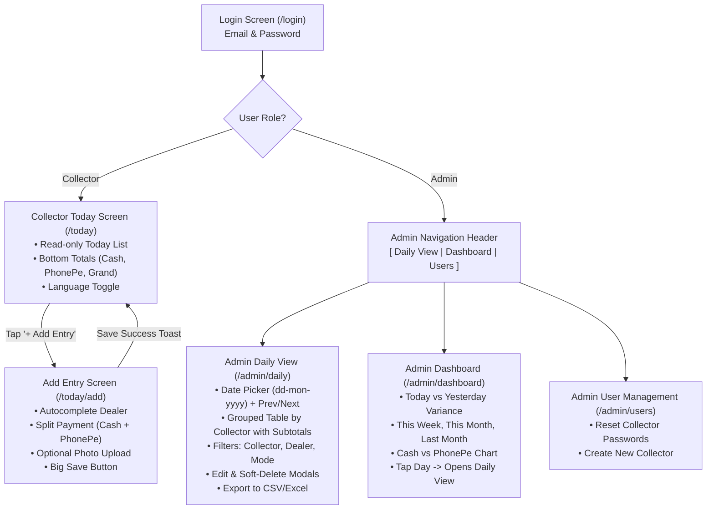

# Screen Specifications & Wireframes: Daily Collection Tracker

## 1. UX Design Principles & Mobile Ergonomics

1. **Extreme Mobile Simplicity for Collectors**:
   * One-handed operation while holding a motorcycle handle or standing in a shop.
   * Large touch targets: Minimum button height is 52px; input fields are 48px with 16px+ font size (prevents mobile Safari from zooming in).
   * Big tactile confirmation: A distinct green banner with checkmark, audio click/vibration (via Web Vibration API `navigator.vibrate([100, 50, 100])`), and instant return to Today list.
2. **Strict Date Presentation**:
   * All dates formatted explicitly as `dd-mon-yyyy` (e.g. `07-Oct-2026` or `18-Oct-2026`).
   * Collector screen displays today's date in a prominent top banner with **no date picker** and **no history button**.
3. **Currency & Number Formatting**:
   * Standard Indian number format: `₹ 1,25,000.00` or `₹ 750.00`.
   * Keyboards configured as numeric (`inputmode="decimal"` or `inputmode="numeric"`).
4. **Bilingual Support (English & Telugu)**:
   * Header contains a toggle: `[ EN | తెలుగు ]`.
   * Choice is stored in `profiles.language_preference` and `localStorage`.

---

## 2. Information Architecture & Navigation Flow



---

## 3. Screen 1: Login Screen (`/login`)

### Purpose
Single responsive login screen for both Admin and Collectors. Authenticates against Supabase Auth. Redirects Admin to `/admin/daily` and Collectors to `/today`.

### Text Wireframe
```text
+-------------------------------------------------------------+
|                                              [ EN | తెలుగు ]|
|                                                             |
|                   [ App Icon: Rupee Badge ]                 |
|                   DAILY COLLECTION TRACKER                  |
|                    రోజువారీ వసూళ్ల ట్రాకర్                     |
|                                                             |
|   +-----------------------------------------------------+   |
|   | Email / ఈమెయిల్                                      |   |
|   | collector1@ithinkai.in                              |   |
|   +-----------------------------------------------------+   |
|                                                             |
|   +-----------------------------------------------------+   |
|   | Password / పాస్‌వర్డ్                                |   |
|   | •••••••••••••                                       |   |
|   +-----------------------------------------------------+   |
|                                                             |
|   +-----------------------------------------------------+   |
|   |                     LOGIN / లాగిన్                   |   |
|   |                  (52px Primary Button)              |   |
|   +-----------------------------------------------------+   |
|                                                             |
|            Need help? Contact Admin: 9876543210             |
+-------------------------------------------------------------+
```

---

## 4. Screen 2: Collector Today Screen (`/today`)

### Purpose
Collector's home screen. Shows today's date (server-calculated IST), list of entries entered by the collector today, and a fixed bottom summary bar. No date picker or past history is accessible.

### Text Wireframe
```text
+-------------------------------------------------------------+
| [⚡ Tracker]   Operator 1 (Ramesh)            [ EN | తెలుగు ]|
+-------------------------------------------------------------+
| 📅 TODAY: 07-Oct-2026 (IST)                                  |
| You have logged 9 collections today                         |
+-------------------------------------------------------------+
| [ BUSINESS FILTER TABS - Fortune 5 Pill Switch ]            |
| [ ALL (₹ 74,000) ]  [ STAR (₹ 61,500) ]  [ ARBO PLAST (₹ 12,500) ] |
+-------------------------------------------------------------+
| [ Top Sticky Summary Cards - Glassmorphism Aesthetic ]      |
| +---------------------+ +---------------------+             |
| | CASH / నగదు          | | PHONEPE / ఫోన్‌పే   |             |
| | ₹ 9,500             | | ₹ 64,500            |             |
| +---------------------+ +---------------------+             |
| | GRAND TOTAL / మొత్తం వసూలు: ₹ 74,000          |             |
+-------------------------------------------------------------+
| TODAY'S COLLECTIONS:                                        |
|                                                             |
| +---------------------------------------------------------+ |
| | [STAR] 10:15 AM    ANGLI LAHT                           | |
| | TOTAL: ₹ 6,000 [Cash Only]                              | |
| | • Cash: ₹ 6,000   • PhonePe: ₹ 0                        | |
| | Balance Owed: ₹ 72,370   📷 Slip Attached               | |
| +---------------------------------------------------------+ |
|                                                             |
| +---------------------------------------------------------+ |
| | [STAR] 12:30 PM    MPL MAHESWARA                        | |
| | TOTAL: ₹ 40,000 [PhonePe]                               | |
| | • Cash: ₹ 0       • PhonePe: ₹ 40,000                   | |
| | Balance Owed: ₹ 87,500   📷 Slip Attached (TOTAL P.P)   | |
| +---------------------------------------------------------+ |
|                                                             |
| +---------------------------------------------------------+ |
| | [ARBO PLAST] 01:15 PM    GKD Vinayaka                   | |
| | TOTAL: ₹ 2,500 [PhonePe]                                | |
| | • Cash: ₹ 0       • PhonePe: ₹ 2,500                    | |
| | Balance Owed: ₹ 0 (Nil)                                 | |
| +---------------------------------------------------------+ |
|                                                             |
| +---------------------------------------------------------+ |
| | [ARBO PLAST] 01:45 PM    SRGP Gangadhar                 | |
| | TOTAL: ₹ 10,000 [PhonePe]                               | |
| | • Cash: ₹ 0       • PhonePe: ₹ 10,000                   | |
| | Balance Owed: ₹ 10,791                                  | |
| +---------------------------------------------------------+ |
|                                                             |
| [ Scrollable space for more items... ]                      |
|                                                             |
+-------------------------------------------------------------+
| [ FIXED BOTTOM ACTION BAR - 70px Height ]                   |
| +---------------------------------------------------------+ |
| |         + ADD NEW ENTRY / కొత్త ఎంట్రీని జోడించండి       | |
| |                     (56px Green Button)                 | |
| +---------------------------------------------------------+ |
+-------------------------------------------------------------+
```

---

## 5. Screen 3: Collector Add Entry Screen (`/today/add`)

### Purpose
Fast entry creation screen. Features dealer name autocomplete, split-payment inputs, optional slip photo capture with client-side compression, and a tactile confirmation banner.

### Text Wireframe
```text
+-------------------------------------------------------------+
| [< Back to Today]         Add Collection / ఎంట్రీని జోడించండి |
+-------------------------------------------------------------+
| 📅 Date: 18-Oct-2026 (Automatic)                            |
+-------------------------------------------------------------+
|                                                             |
| 1. DEALER NAME / డీలర్ పేరు *                                |
| +---------------------------------------------------------+ |
| | Sri|                                              🔍    | |
| +---------------------------------------------------------+ |
| | [Suggestions Dropdown]                                  | |
| | -> Sri Lakshmi Supermarket                              | |
| | -> Sri Balaji Provision Store                           | |
| | -> Sri Venkateswara Kirana                              | |
| +---------------------------------------------------------+ |
|                                                             |
| 2. CASH AMOUNT / నగదు మొత్తం (₹)                            |
| +---------------------------------------------------------+ |
| | ₹ 1500                                                  | |
| +---------------------------------------------------------+ |
|                                                             |
| 3. PHONEPE AMOUNT / ఫోన్‌పే మొత్తం (₹) (Blank = 0)          |
| +---------------------------------------------------------+ |
| | ₹ 3500                                                  | |
| +---------------------------------------------------------+ |
|                                                             |
| [ DYNAMIC TOTAL HIGHLIGHT BOX ]                             |
| +---------------------------------------------------------+ |
| | TOTAL COLLECTED / మొత్తం వసూలు:  ₹ 5,000                  | |
| +---------------------------------------------------------+ |
|                                                             |
| 4. BALANCE OWED / మిగిలిన బాకీ (₹) (Optional)                |
| (What dealer still owes after this payment)                 |
| +---------------------------------------------------------+ |
| | ₹ 2000                                                  | |
| +---------------------------------------------------------+ |
|                                                             |
| 5. NOTE / గమనిక (Optional)                                  |
| +---------------------------------------------------------+ |
| | Discount applied for next month                         | |
| +---------------------------------------------------------+ |
|                                                             |
| 6. BILL / SLIP PHOTO (Optional)                             |
| +---------------------------------------------------------+ |
| | [ 📷 Take Photo / కెమెరా ]   [ 📁 Choose File ]          | |
| | Preview: [ Thumbnail: slip_18oct.jpg (420 KB) ] [x]     | |
| +---------------------------------------------------------+ |
|                                                             |
| +---------------------------------------------------------+ |
| |              SAVE ENTRY / ఎంట్రీని సేవ్ చేయండి            | |
| |                   (56px Primary Button)                 | |
| +---------------------------------------------------------+ |
+-------------------------------------------------------------+

[ SUCCESS TOAST / OVERLAY ]
+-------------------------------------------------------------+
|  ✅ Entry Saved Successfully! / ఎంట్రీ విజయవంతంగా సేవ్ అయింది |
|  Sri Lakshmi Supermarket: ₹ 5,000                           |
+-------------------------------------------------------------+
```

---

## 6. Screen 4: Admin Daily View (`/admin/daily`)

### Purpose
Admin's primary day-to-day command center. Shows every transaction for the selected date from all 3 collectors, grouped by collector with subtotals, multi-attribute filters, and grand totals.

### Text Wireframe
```text
+----------------------------------------------------------------------------------------------------+
| [Tracker Logo]   [ DAILY VIEW ]   [ DASHBOARD ]   [ USERS ]   Admin (Srinivas)       [ EN | తెలుగు ]|
+----------------------------------------------------------------------------------------------------+
| DATE NAVIGATION:                                                                                   |
| [ < Prev Day (17-Oct) ]     [ 📅 18-Oct-2026 ]     [ Next Day (19-Oct) > ]     [ Today ]           |
+----------------------------------------------------------------------------------------------------+
| FILTERS & SEARCH:                                                                                  |
| Collector: [ All Collectors v ]   Payment Mode: [ All Modes v ]   Search Dealer: [ Sri Lakshmi... ]|
| [ 📥 Export to Excel ]   [ 📥 Export to CSV ]                                                      |
+----------------------------------------------------------------------------------------------------+
|                                                                                                    |
| === COLLECTOR 1: Ramesh Kumar (Subtotal: Cash: ₹ 3,700 | PhonePe: ₹ 3,500 | Total: ₹ 7,200) ===     |
| +----------+---------------------------+-----------+-----------+-----------+-----------+-----+---+ |
| | Time     | Dealer Name               | Cash (₹)  | PhonePe(₹)| Total (₹) | Bal. Owed | Slip|Act| |
| +----------+---------------------------+-----------+-----------+-----------+-----------+-----+---+ |
| | 10:45 AM | Sri Lakshmi Supermarket   |  1,500.00 |  3,500.00 |  5,000.00 |  2,000.00 | 📷  |✏️🗑️| |
| | 11:30 AM | Balaji Traders            |  2,200.00 |      0.00 |  2,200.00 |      0.00 |  -  |✏️🗑️| |
| +----------+---------------------------+-----------+-----------+-----------+-----------+-----+---+ |
|                                                                                                    |
| === COLLECTOR 2: Venkat Rao (Subtotal: Cash: ₹ 1,200 | PhonePe: ₹ 4,800 | Total: ₹ 6,000) ===       |
| +----------+---------------------------+-----------+-----------+-----------+-----------+-----+---+ |
| | Time     | Dealer Name               | Cash (₹)  | PhonePe(₹)| Total (₹) | Bal. Owed | Slip|Act| |
| +----------+---------------------------+-----------+-----------+-----------+-----------+-----+---+ |
| | 12:15 PM | Kalyani Agencies          |      0.00 |  4,800.00 |  4,800.00 |  1,200.00 | 📷  |✏️🗑️| |
| | 01:20 PM | New City Kirana           |  1,200.00 |      0.00 |  1,200.00 |    500.00 |  -  |✏️🗑️| |
| +----------+---------------------------+-----------+-----------+-----------+-----------+-----+---+ |
|                                                                                                    |
| === COLLECTOR 3: Mahesh Reddy (No entries logged yet today) =====================================  |
|                                                                                                    |
+----------------------------------------------------------------------------------------------------+
| [ FIXED BOTTOM GRAND TOTAL BAR ]                                                                   |
| Total Cash: ₹ 4,900.00   |   Total PhonePe: ₹ 8,300.00   |   GRAND TOTAL: ₹ 13,200.00 (4 Entries)  |
+----------------------------------------------------------------------------------------------------+
```

---

## 7. Screen 5: Admin Edit & Soft-Delete Modals

### Edit Entry Modal (`/admin/daily?edit=:id`)
```text
+---------------------------------------------------------+
| Edit Entry - Sri Lakshmi Supermarket                [X] |
+---------------------------------------------------------+
| Collector: Ramesh Kumar     Time: 10:45 AM (18-Oct-2026)|
|                                                         |
| Dealer Name:    [ Sri Lakshmi Supermarket             ] |
| Cash Amount (₹):[ 1500.00                             ] |
| PhonePe Amount: [ 3500.00                             ] |
| Balance Owed (₹)[ 2000.00                             ] |
| Note:           [ Split payment via QR                ] |
| Reason for Edit: (Required for Audit Log)               |
| +-----------------------------------------------------+ |
| | Dealer confirmed ₹500 extra paid in cash             | |
| +-----------------------------------------------------+ |
|                                                         |
| [ Cancel ]                            [ Update Entry ]  |
+---------------------------------------------------------+
```

### Soft-Delete Confirmation Modal (`/admin/daily?delete=:id`)
```text
+---------------------------------------------------------+
| ⚠️ Confirm Delete Entry                             [X] |
+---------------------------------------------------------+
| Are you sure you want to delete this collection entry?  |
|                                                         |
| Dealer: Balaji Traders                                  |
| Amount: ₹ 2,200.00 (Cash)                               |
| Collector: Ramesh Kumar                                 |
|                                                         |
| Reason for Deletion: *                                  |
| +-----------------------------------------------------+ |
| | Duplicate entry entered by mistake                   | |
| +-----------------------------------------------------+ |
|                                                         |
| [ Keep Entry ]                [ 🗑️ Confirm Delete ]    |
+---------------------------------------------------------+
```

---

## 8. Screen 6: Admin Dashboard (`/admin/dashboard`)

### Purpose
Executive performance overview. Displays key date-comparison metrics, day-to-day variance percentage, cash vs PhonePe payment mix, and collector leaderboard. Every card and chart bar is clickable to drill down into the full Daily View for that date.

### Text Wireframe
```text
+----------------------------------------------------------------------------------------------------+
| [Tracker Logo]   [ DAILY VIEW ]   [ DASHBOARD ]   [ USERS ]   Admin (Srinivas)       [ EN | తెలుగు ]|
+----------------------------------------------------------------------------------------------------+
| EXECUTIVE SUMMARY CARDS (Click any card to inspect that date):                                     |
| +-----------------------+ +-----------------------+ +-----------------------+ +------------------+ |
| | TODAY (18-Oct)        | | YESTERDAY (17-Oct)    | | THIS WEEK (12-18 Oct) | | THIS MONTH (Oct) | |
| | ₹ 13,200.00           | | ₹ 11,800.00           | | ₹ 84,500.00           | | ₹ 2,34,000.00    | |
| | 📈 +11.8% vs Yesterday| |                       | | 6 Days active         | | 18 Days active   | |
| +-----------------------+ +-----------------------+ +-----------------------+ +------------------+ |
+----------------------------------------------------------------------------------------------------+
| VISUAL CHARTS & BREAKDOWNS:                                                                        |
|                                                                                                    |
| [ CHART 1: PAYMENT MODE MIX (Today) ]          [ CHART 2: COLLECTOR BREAKDOWN (Today) ]            |
|                                                                                                    |
|      PhonePe: 63% (₹ 8,300)                          Ramesh: ████████████ (₹ 7,200)                |
|      Cash:    37% (₹ 4,900)                          Venkat: ██████████   (₹ 6,000)                |
|                                                      Mahesh: (₹ 0)                                 |
|                                                                                                    |
| [ CHART 3: 7-DAY COLLECTION TREND (Bar chart with daily variance) ]                                |
|   ₹15k |              █                                                                            |
|   ₹12k |        █     █                                                                            |
|   ₹10k |  █     █  █  █                                                                            |
|    ₹5k |  █  █  █  █  █                                                                            |
|        +--+--+--+--+--+--+--                                                                       |
|          12 13 14 15 16 17 18 (Oct)                                                                |
+----------------------------------------------------------------------------------------------------+
```

---

## 9. Screen 7: Admin User Management Screen (`/admin/users`)

### Purpose
Allows the Admin to manage the 3 collectors, reset forgotten passwords, and view their latest login activity.

### Text Wireframe
```text
+----------------------------------------------------------------------------------------------------+
| [Tracker Logo]   [ DAILY VIEW ]   [ DASHBOARD ]   [ USERS ]   Admin (Srinivas)       [ EN | తెలుగు ]|
+----------------------------------------------------------------------------------------------------+
| FIELD COLLECTORS (Max 3):                                                [ + Create Collector ]    |
|                                                                                                    |
| +-------------------+-----------------------+----------+--------------------+--------------------+ |
| | Name              | Email                 | Language | Last Active        | Actions            | |
| +-------------------+-----------------------+----------+--------------------+--------------------+ |
| | Ramesh Kumar      | collector1@ithinkai.in| Telugu   | Today, 11:30 AM    | [ Reset Password ] | |
| | Venkat Rao        | collector2@ithinkai.in| Telugu   | Today, 01:20 PM    | [ Reset Password ] | |
| | Mahesh Reddy      | collector3@ithinkai.in| English  | Yesterday, 6:00 PM | [ Reset Password ] | |
| +-------------------+-----------------------+----------+--------------------+--------------------+ |
+----------------------------------------------------------------------------------------------------+
```

---

## 10. Progressive Web App (PWA) Offline UX & Confirmation

1. **Installability**:
   * Automatic "Add to Home Screen" prompt for Android (Chrome) and visual guide for iOS (Safari: "Tap Share -> Add to Home Screen").
2. **Offline Detection**:
   * If collector loses 4G connectivity: A subtle amber banner appears: `⚠️ Offline - Changes will sync when connected`.
   * Form submit button disables with: `Cannot save while offline. Check internet connection.` to guarantee database consistency without complex conflict resolution.
3. **Confirmation Pattern**:
   * Once saved, an affirmative 2-second green overlay toast appears, providing acoustic/haptic feedback, and auto-navigates back to `/today`.
